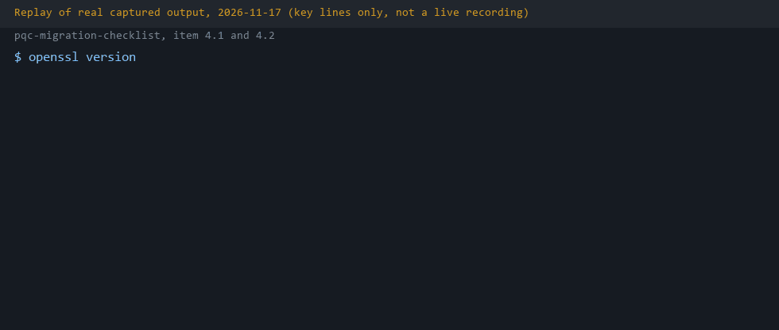

# Post-Quantum Cryptography Migration Checklist

A testable yes/no checklist for planning and reviewing a migration from quantum-vulnerable public-key cryptography to post-quantum cryptography (PQC). Every item names a quick test and the source it rests on.

> Last verified: 2026-11-17. **NIST IR 8547 is final (27 October 2026).** Many articles still describe the November 2024 draft. See [What was not verified](#what-was-not-verified), including why NSA CNSA 2.0 dates are not listed.

*Items 4.1 and 4.2 run on a real host. The GIF is a replay of captured output, filtered to the key lines, not a live recording. The raw capture is in [docs/demo-capture.txt](docs/demo-capture.txt).*

## How to use it

Want only the tick boxes? Copy [CHECKLIST.md](CHECKLIST.md).

1. Copy the checklist into a migration plan or review ticket.
2. Tick an item only after you ran its test and kept the output.
3. Sections 1 to 3 are the foundation. Sections 4 to 6 build on them.

Federal deadlines in this repo apply to US federal systems. Other organisations can use them as a benchmark, not as a legal requirement.

## 1. Inventory

You cannot migrate what you have not found. Basis: OMB M-23-02 (18 November 2022) required an annual cryptographic inventory. The CISA, NSA and NIST fact sheet (21 August 2023) notes that discovery tools can miss embedded cryptography.

- [ ] **1.1** A cryptographic inventory exists as a CycloneDX CBOM (version 1.6 or later) with `cryptographic-asset` components. *Test:* validate the file against the CycloneDX 1.6 or 1.7 JSON schema and confirm every algorithm component has `cryptoProperties.assetType` set. *Basis:* CBOM was introduced in CycloneDX 1.6 (9 April 2024). Valid `assetType` values: algorithm, certificate, protocol, related-crypto-material.
- [ ] **1.2** Each inventory record carries the M-23-02 fields: algorithm, service provided, key length, vendor, operating system, hosting, and data time to live. *Test:* sample five records and check every field is filled. *Basis:* OMB M-23-02.
- [ ] **1.3** The inventory is refreshed on a schedule and covers embedded and third-party cryptography. *Test:* show the last refresh date and a vendor-supplied entry. *Basis:* CISA/NSA/NIST fact sheet.

## 2. Prioritisation and timelines

Basis: NIST IR 8547 final, "Transition to Post-Quantum Cryptography Standards", 27 October 2026. It states that NIST "will deprecate quantum-vulnerable public-key cryptography after 2030 and disallow its use under NIST standards and guidelines after 2035." Its transition table lists ECDSA and RSA (112 bits of classical strength or more) and EdDSA (128 bits or more) as "Deprecated after 2030, Disallowed after 2035". It does **not** say RSA is disallowed in 2030.

- [ ] **2.1** Every use of RSA, ECDSA, EdDSA, finite-field DH and elliptic-curve DH is listed with a planned replacement. *Test:* count inventory entries for these algorithms that have no migration entry. Expect zero. *Basis:* NIST IR 8547.
- [ ] **2.2** Each data class has a recorded secrecy lifetime and an estimated migration time. *Test:* confirm both fields exist for the five most sensitive data classes. *Basis:* harvest-now-decrypt-later risk as described in the CISA/NSA/NIST fact sheet, and the "time to live" field in OMB M-23-02.
- [ ] **2.3** (US federal) For high value assets and high-impact systems, the plan has dated milestones for PQC key establishment by 31 December 2030 and PQC digital signatures by 31 December 2031. *Test:* check both dates appear as milestones. *Basis:* NIST IR 8547, citing EO 14412 (22 June 2026) and OMB M-26-15 (24 June 2026).
- [ ] **2.4** All endpoints support TLS 1.3 by 2 January 2030. *Test:* scan the endpoint inventory for TLS versions and list those below 1.3. *Basis:* EO 14306, OMB M-26-15, NIST IR 8547.
- [ ] **2.5** (UK) The plan has dated checkpoints for 2028 (discovery and initial plan), 2031 (highest-priority migration) and 2035 (complete). *Test:* check the three dates appear in the plan. *Basis:* [UK NCSC PQC migration timelines](https://www.ncsc.gov.uk/guidance/pqc-migration-timelines), 20 March 2025.
- [ ] **2.6** (EU) The plan starts by the end of 2026 and covers critical infrastructure by the end of 2030. *Test:* check both dates. *Basis:* [EU coordinated roadmap news item](https://digital-strategy.ec.europa.eu/en/news/eu-reinforces-its-cybersecurity-post-quantum-cryptography), 23 June 2025.

## 3. Algorithm choices

Basis: NIST FIPS 203 (ML-KEM), FIPS 204 (ML-DSA) and FIPS 205 (SLH-DSA), all final on 13 August 2024.

- [ ] **3.1** New PQC deployments specify only FIPS 203, 204 or 205 algorithms. *Test:* scan configuration baselines for any other PQC algorithm name. *Basis:* FIPS 203, 204, 205.
- [ ] **3.2** FN-DSA (FALCON-derived) and HQC are marked "not yet approved" and absent from production. *Test:* search configuration baselines for both and expect none. *Basis:* NIST IR 8547 says NIST "is developing a FIPS" for FN-DSA and that a FIPS for HQC-KEM "is under development". HQC was selected on 11 March 2025.
- [ ] **3.3** ML-KEM-768 is the default parameter set unless an exception is recorded. *Test:* list ML-KEM parameter sets in use and confirm each exception has a reason. *Basis:* NIST IR 8547: "NIST recommends using ML-KEM-768 as the default parameter set".
- [ ] **3.4** KEM use follows NIST SP 800-227 (final, 18 September 2025). *Test:* name the SP 800-227 section that governs each KEM use. *Basis:* SP 800-227.
- [ ] **3.5** The hybrid-versus-pure decision is recorded per jurisdiction, not as one global yes or no. *Test:* show the policy rule for each jurisdiction you operate in. *Basis:* BSI says PQC schemes should only be used in combination with classical ones. ANSSI "strongly emphasizes the necessity of hybridation". OMB M-26-15 calls hybrid "an intricate and resource-intensive stopgap".

## 4. Protocol deployment

- [ ] **4.1** External TLS endpoints negotiate `X25519MLKEM768` where the stack supports it. *Test:* with OpenSSL 3.5 or later run `openssl s_client -connect HOST:443 -groups X25519MLKEM768 -brief` and look for the line `Negotiated TLS1.3 group: X25519MLKEM768`. *Verified:* run on 2026-11-17 with OpenSSL 3.5.7 against a public host. *Basis:* RFC 10024 (X25519MLKEM768, Proposed Standard, August 2026). OpenSSL 3.5.0 added ML-KEM, ML-DSA and SLH-DSA and offers `X25519MLKEM768` by default.
- [ ] **4.2** SSH servers on OpenSSH 10.0 or later keep `mlkem768x25519-sha256` enabled. *Test:* `ssh -Q kex` lists `mlkem768x25519-sha256`, and `ssh -vv HOST` shows it negotiated. *Verified:* the `ssh -Q kex` listing was confirmed on OpenSSH 10.3p1. The negotiated-algorithm line in `ssh -vv` was not run. *Basis:* OpenSSH 10.0 release notes (9 April 2025) made it the default key agreement.
- [ ] **4.3** Certificate and CMS profiles use the published RFCs: RFC 9881 (ML-DSA in X.509), RFC 9935 (ML-KEM in X.509) and RFC 9936 (ML-KEM in CMS). *Test:* name the RFC each issuance profile follows. *Basis:* the RFCs.
- [ ] **4.4** Certificate chain size is measured before any ML-DSA rollout. *Test:* record chain bytes before and after a trial swap. *Basis:* Cloudflare reported in October 2025 that a drop-in ML-DSA-44 swap adds about 15 kB and more than doubles the bytes for most QUIC connections (a point-in-time measurement). See [Cloudflare pq-2025](https://blog.cloudflare.com/pq-2025/).

## 5. Crypto agility

- [ ] **5.1** Algorithm names and parameter sets are configuration values, not hardcoded. *Test:* grep source for hardcoded algorithm identifiers and count them. *Basis:* OMB M-26-15 requires systems to be "cryptographically agile".
- [ ] **5.2** A swap of one algorithm in one service has been rehearsed in a test environment. *Test:* show the change record and the rollback. *Basis:* good practice. NIST CSWP 39 covers crypto agility, but only its existence and dates were verified.

## 6. Governance and evidence

- [ ] **6.1** A named owner and a dated migration plan exist. *Test:* show both. *Basis:* OMB M-26-15 requires a plan within 120 days of its issue for federal agencies, as a benchmark for others.
- [ ] **6.2** The inventory and the plan are reviewed at least once a year, and when a standard changes. *Test:* show the last review date and what changed. *Basis:* OMB M-23-02 required annual inventory. FIPS 203 and 204 both carry NIST notes (dated 2025-11-17 and 2026-07-31) that corrections will come in a future revision.

## Scoring

| Result | Meaning |
| --- | --- |
| Sections 1 to 3 all ticked | A credible migration plan exists |
| Any of sections 1 to 3 unticked | Not ready to commit dates |
| Sections 4 to 6 unticked | Allowed only with a written exception and an owner |

## Verified references

Retrieved 2026-11-17. Items marked "PDF" were read from the primary document text.

| Fact | Source |
| --- | --- |
| NIST IR 8547 final, 27 Oct 2026. Deprecate after 2030, disallow after 2035 (PDF). ML-KEM-768 recommended as default (PDF). FN-DSA and HQC FIPS in development (PDF). Federal deadlines of 31 Dec 2030 and 31 Dec 2031, TLS 1.3 by 2 Jan 2030 (PDF) | [IR 8547 final](https://csrc.nist.gov/pubs/ir/8547/final), [PDF](https://nvlpubs.nist.gov/nistpubs/ir/2026/NIST.IR.8547.pdf) |
| FIPS 203, 204, 205 final, 13 Aug 2024 | [FIPS 203](https://csrc.nist.gov/pubs/fips/203/final), [204](https://csrc.nist.gov/pubs/fips/204/final), [205](https://csrc.nist.gov/pubs/fips/205/final) |
| NIST SP 800-227 final, 18 Sep 2025 | [SP 800-227](https://csrc.nist.gov/pubs/sp/800/227/final) |
| EO 14412, 22 June 2026; OMB M-26-15, 24 June 2026 | [EO 14412](https://www.whitehouse.gov/presidential-actions/2026/06/securing-the-nation-against-advanced-cryptographic-attacks/), [M-26-15 PDF](https://www.whitehouse.gov/wp-content/uploads/2026/06/M-26-15-Execution-of-the-Migration-to-Post-Quantum-Cryptography.pdf) |
| OMB M-23-02, 18 Nov 2022 | [M-23-02 PDF](https://www.whitehouse.gov/wp-content/uploads/2022/11/M-23-02-M-Memo-on-Migrating-to-Post-Quantum-Cryptography.pdf) |
| CISA, NSA and NIST fact sheet, 21 Aug 2023 | [CISA page](https://www.cisa.gov/resources-tools/resources/quantum-readiness-migration-post-quantum-cryptography) |
| RFC 10024, RFC 9954, RFC 9794, RFC 9881, RFC 9935, RFC 9936 | [rfc-editor.org](https://www.rfc-editor.org/) |
| CycloneDX CBOM introduced in 1.6 (9 Apr 2024); 1.7 announced 21 Oct 2025 | [CycloneDX 1.6 JSON](https://cyclonedx.org/docs/1.6/json/) |
| OpenSSL 3.5.0 (8 Apr 2025) PQC support; OpenSSH 10.0 (9 Apr 2025) default `mlkem768x25519-sha256` | [OpenSSL NEWS](https://github.com/openssl/openssl/blob/master/NEWS.md), [OpenSSH release notes](https://www.openssh.org/releasenotes.html) |

## What was not verified

- **NSA CNSA 2.0 is not covered.** nsa.gov and media.defense.gov blocked automated access, and secondary sources disagree on its dates. If you work with national security systems, read the NSA advisory directly and record its version and date. Do not take CNSA 2.0 dates from this repo.
- The SP 800-56B row of IR 8547 Table 4 could not be read cleanly. Confirm it visually in the PDF.
- IR 8547 final was not compared line by line against the 2024 draft.
- NIST SP 1800-38 (final status), the Mosca inequality formula, and exact ML-KEM and ML-DSA byte sizes were not verified.
- RFC 10024 codepoint `0x11EC` is as reported by the IETF datatracker. The IANA registry was not checked.
- The EU roadmap milestone "as many systems as feasible by 2035" was seen only in a search summary and is excluded.
- NIST CSWP 39 body text was not read.
- The exact `ssh -vv` negotiated-algorithm output was not run.

Found a wrong or untestable item? Use the issue forms or open a pull request (a template guides you). Each item must be a yes/no question with a test, and each new claim needs a primary source.

## Related checklists

- [MCP security checklist](https://github.com/sunilgentyala/mcp-security-checklist)
- [Privacy engineering checklist](https://github.com/sunilgentyala/privacy-engineering-checklist)

## License

MIT
